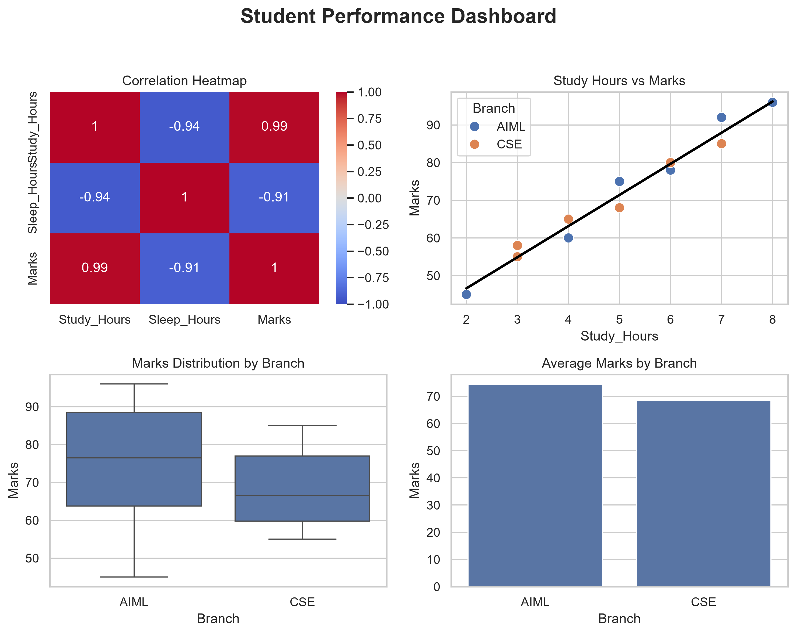

# Student Performance Analysis Dashboard

## Project Overview
This project uses Python, Pandas, Matplotlib, and Seaborn to explore student performance data through visualizations.

## Visualizations
- **Correlation Heatmap:** Examines relationships between study hours, sleep hours, and marks.
- **Regression Analysis:** Visualizes the relationship between study hours and marks.
- **Boxplot:** Compares marks distributions across AIML and CSE branches.
- **Barplot:** Compares average marks across branches.

## Dashboard Preview



## Key Findings
- AIML students have an average score of 86.0.
- CSE students have an average score of 68.5.
- Study hours and marks show a positive relationship in this sample.
- The results describe this small sample and do not establish causation.

## Tools Used
- Python
- Pandas
- Matplotlib
- Seaborn

## Files
- `seaborn_day4_project.py` — Source code
- `student_performance_dashboard.png` — Exported dashboard

## How to Run
Install the required libraries if needed, then run:

```bash
python seaborn_day4_project.py
```
